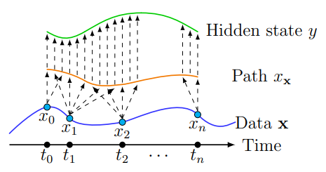

## Notes on Kidger's NDEs talks
This is a compilation of notes mostly based on Patrick Kidger's talks across two to three seminars. The aim here is to provide a very high-level overview of subfields within NDEs.
### NDEs Overview

A neural differential equation is *a differential equation (DE) that uses a neural network (NN) with learnable parameters/functions to parametrize its vector field*. A canonical starter example is a **neural ordinary differential equation** (NODE): 

$$ 
y(0) = y_0 \hspace{1cm} \frac{dy}{dt}(t) = f_\theta(t, y(t))
$$ 

where $f_\theta: \mathbb{R} \times\mathbb{R}^d \to \mathbb{R}^d$ is some standard neural architecture, oftentimes a feed-forward one. The central idea here is that, instead of treating an ODE solver (e.g. RK4) as an external black-box that just produces numerical solutions, we now embed it inside an NN's differentiable computation graph. 

Remark: Traditionally, solvers only integrate and simulate the evolution of DEs with fixed parameters (e.g. of a physical/biological system), without caring how their outputs vary with respect to those parameters. They are used to generate data for an NN, which is trained afterward on these simulated data to approximate the underlying system, making it a separate pipeline from the solver. 

More ground-level details about NODE

In an NODE, the dynamics of the ODE are defined by an NN $f_\theta$ with learnable parameters. To train this NN, it's of course essential to understand how changes in $\theta$ influence the integrated solution $y$. By recording and encompassing the solver's internal numerical steps in the differentiable computation graph, auto-differentiation can propagate gradients from the loss function back through the solver and into the NN that defines how $y$ evolves, "nudging" the parameters along the way so that the learned dynamics better match the data. This turns the solver into a trainable component of the model, enabling end-to-end learning where the system learns not just static (plain "input $\to$ output") mappings, but the continuous-time evolution described by the ODE itself.

Note that the ODE describes the evolution of $y$, which lives in a *latent space* (some internal representation of the raw input space). The solver integrates this NODE from $y(0)$ (the encoded input) to $y(T)$, then passes $y(T)$ through affine and softmax layers to get output/predictions and compute a loss.

...

...

It's worth mentioning that this seemingly complicated nesting of an NN inside an DE is nothing groundbreaking from a mathematics or ML point of view alone. For example, the SIR model in mathematical epidemiology is as follows:

$$
\frac{d}{dt} 
\begin{pmatrix} 
s(t) \\ i(t) \\ r(t) 
\end{pmatrix} 
= \begin{pmatrix} 
-b s(t)i(t) \\ b s(t)i(t) - k i(t) \\ k i(t) 
\end{pmatrix}. 
$$

Both NODEs and the SIR model are parametrized DEs with some theoretical models for the RHS, with the mere difference being that SIR is specialized to fit a specific phenomenon (namely the evolution of a disease), while an NODE is a generalized "fitter" applicable to lots of things thanks to the NN architecture. In fact, the SIR model can transform into an NODE by making the parameters $b$ and $k$ learnable.

In the framework of deep learning (DL), we may also see a shadow of NODE: by applying Euler method to $\frac{dy}{dt}(t) = f_\theta(t, y(t))$, we obtain a residual network (ResNet): 

$$ 
y_{t_{n+1}} = y_{t_{n}} + \Delta tf_\theta(t_n, y_{t_{n}}).
$$

Interestingly, this connection between DL architectures and NDEs is ubiquitous: 
1. ResNet $\leftrightarrow$ neural ordinary differential equations (NODEs)
2. GRUs/LSTMs $\leftrightarrow$ **neural controlled differential equations** (NCDEs)
3. StyleGAN2 $\leftrightarrow$ **neural stochastic differential equations** (NSDEs)

NDEs have a myriad of applications in real life, often demonstrating state-of-the-art performance in areas like systematic modelling (physical, biological, financial, etc), regular/irregular time series analysis, generative modelling, and many more.

Advantages of NDE approaches:
- NDEs offer practically a best-of-both-world approach: the NN side offers high-capacity function approximation and high trainability, while the DE side offers strong prior on model space, memory-efficiency (adjoint backpropagation), and theoretical understanding via well-understood mathematics. 
- The NN side supplements the DE side when purely mechanistic models fail to capture real-world complexity, while the DE side brings a coherent theory and structural consistency/interpretability to the NN side.
- Because of their continuous nature, NDEs naturally handle irregular/asynchronous data, at which discrete-time models like RNNs struggle. 

However, NDEs are not without their limitations (speed of computation (might be an implementation issue regarding Python vs C++), number of parameters that insinuates low interpretability and potential overfitting, etc), but we won't discuss much about them here.

### NCDEs Overview

#### What is a CDE?
Motivation: consider the integral form of the NODE we saw above: 

$$
y(0) = y_0 \hspace{1cm} y(t) = y(0) + \int_0^t f_\theta(y(s))ds
$$

which takes the initial condition as the single input. Here, an extra "artificial" time-like dimension is introduced and integrated over, so it's natural to ask if the model can be extended to data of sequential nature (e.g. time series). That is, if we observe some ordered data $(y_0,\ldots,y_n)$ and would like to align this new dimension with the natural ordering of the data, how do we extend the $y(0)=y_0$ condition to one resembling (with the timestamps not necessarily looking like) $``y(0)=y_0,\ldots,y(n)=y_n"$? Since the initial condition at $y(0)$ determines the solution of an ODE, there is no direct mechanism for incorporating the late-coming data. This is where CDEs come into play.

The main idea of a CDE is to have the local dynamics $y$ of the system depend on some time-varying input (path) $X:[0, T] \to \mathbb{R}^v$ in the form of a Riemann-Stieltjes integral

$$
y(t) = y(0) + \int_0^t f(y(s))dX(s) \hspace{0.5cm} \text{for } t\in [0,T]
$$

where $f(y(s))dX(s)$ is a matrix-vector product and can be interpreted as $f(y(s))\frac{dX}{ds}(s)ds$ as long as $X$ is suitably smooth. $X$ can be thought to determine some local notion of physics and fundamentally, a CDE is an operator on path space $X \mapsto y$ that preserves measurability with respect to a filtration (i.e., causality)

#### What is an NCDE?
Let $X:[0, T] \to \mathbb{R}^v$ be some observed data, for example an interpolation of a time series, and our goal now is to learn NNs $\zeta_\theta$, $f_\theta$, $l_\theta$ such that 

$$
y(0) = \zeta_\theta(X(0)) \hspace{1cm} y(t) = y(0) + \int_0^tf_\theta(y(s))dX(s) 
$$

and the output is either $l_\theta(y(T))$ or $l_\theta(y(t))$.

The framework of NCDEs is essentially a continuous version of recurrent neural network (RNN): $y_{n+1} = f_\theta(y_n, x_n)$, where the discrete inputs $x$ provoke changes in the **hidden state** $y$, just like how $X$ drive changes continuously in $y$ via the CDE that evolves in the latent space (not the data/output space itself directly, hence the $l_\theta$). 

Why do we need this extra latent data?

Because the outputs can then evolve in a nonmarkovian way, and it's rare to find truly markovian data in real life... The $\zeta_\theta$ here acts as the initial encoder that compresses raw/interpolated data into some latent space, which is typically low-dimensional and easier for a model to reason about. For instance, in the context of modelling handwritten digits, the data space can be the position of pen moved over paper over time (as a time series), while the latent space can be a 2D continuous space representing stroke positions and styles. The CDE block acts as a continuous-time encoder describing data-driven hidden-state evolution, yielding a final $y(T)$ which is then passed through the readout map $l_\theta$ to give an output in target space such as a binary classification.

...
  
Remark: One might wonder if there's any connection between control theory and NCDEs. Speaking very broadly, the difference between them is somewhat philosophical: the former studies some fixed system $f$ and attempts to find the optimal $X$ producing the desired response $y$, while the latter has input $X$ fixed and the goal of optimizing $f_\theta$ to give the desired $y$.  

There are many things yet to be addressed:
- We know typically $f_\theta$ is a feed-forward NN, but what are some good choices in initializing $f_\theta$?
- What are some interpolation schemes in constructing $X$? How do we know which one to use?
- The rough path theoretical reasoning behind writing $f_\theta(y(s))dX(s)$ instead of $f_\theta(y(s), X(s))ds$...
- NCDEs are universal approximators for all functional sequences (strong theoretical guarantee): how do we show this and what are its implications?

### NSDEs Overview
#### What is an SDE?
A general SDE has the form 

$$
dX_t = \mu(t, X_t)dt + \sigma(t, X_t)dW_t
$$

where $X$ is some stochastic processes governed by the RHS consisting of drift ($\mu$), diffusion ($\sigma$), and a Wiener process/Brownian noise ($W_t$). Here, $X$, $W$, $\mu$ are vector-valued, and $\sigma$ is matrix-valued. The solution to an SDE is a distribution over paths whose sample paths are just "random curves" in time but all following a certain "law" of the underlying process. In other words, it's a map from Brownian noise and the initial distribution $X_0$ to some distribution over paths: $(X_0, W) \mapsto X$. An *SDE solver* can sample from an SDE, at least approximately, and is trained by matching statistics with payoff functions $F_i$:

$$
\mathbb{E}_XF_i(X) \approx \mathbb{E}_{data}F_i(data)
$$

#### A quick recap on GANs
Given some noise random variable $A(\omega)\in \mathbb{R}^{d_1}$, target random variable $B(\omega)\in \mathbb{R}^{d_2}$, a *generative model* is an NN $g_\theta:\mathbb{R}^{d_1} \to \mathbb{R}^{d_2}$ such that $g_\theta(A) \approx B$. For example, $A$ may be a multivariate normal sample which, after going through $g_\theta$, produces some distribution resembling $B$, the distribution of a cat's picture. We can sample $g_\theta(A(\omega))$, but the main difficulty here lies in the lack of tractable probability density, meaning that we can't train $g_\theta$ with classical approaches like maximum likelihood. So instead, we train $\theta$ to minimize the loss function $W$ defined below, where $F_\phi$ is the discriminator that is responsible for identifying "fake" data and competing against the GAN's generator:

$$
W(g_\theta(A), B) \approx \sup_{\phi} \left|\frac{1}{N}\sum_{i=1}^{N}F_\phi(g_\theta(A(\omega_i))) - \frac{1}{M}\sum_{i=1}^{M}F_\phi(B(\tilde\omega_j))\right|
$$

whose minimizing is essentially matching statistics: 

$$
\mathbb{E}_AF(g_\theta(A)) \approx \mathbb{E}_{B}F(B)
$$

for all "discriminators" (payoff functions) $F$.

The ways that SDE solvers and GANs are trained are very similar, so why not train an SDE as a GAN?

#### What is an NSDE?
Our goal now is to model $B$, a random variable on path space (e.g. a distribution of the time series of option prices over the course of 30 days). To now set up the GAN, we take Brownian motion $W$ and initial noise $V$ (e.g. $\sim \mathcal{N}(0,1)$), alongside NNs $\zeta_\theta$, $\mu_\theta$, $\sigma_\theta$, $l_\theta$. Then we seek to learn an SDE of the form 

$$
X_0 = \zeta_\theta(V) \hspace{0.7cm} dX_t = \mu_\theta(t, X_t)dt +\sigma_\theta(t, X_t)dW_t \hspace{0.7cm} Y_t = l_\theta(X_t)
$$

(with a very flexible initial distribution $X_0$ as it's simply a learnt function of noise $V$) such that $Y \approx B$. Here, $X$ is the hidden state; $Y$ is the output, which are continuous-time paths. Now, we need a discriminator that accepts such objects as input, and a convenient choice for $F_\phi$ would be a CDE (Remember this is an operator between path spaces and we gave an example about classifying handwritten digits? We shall now classify real vs fake time series generated from our SDE using the same CDE framework):

$$
H_0 = \xi_\phi(Y_0) \hspace{1cm} dH_t = f_\phi(t, H_t)dt + g_\phi(t, H_t)dY_t
$$

(slightly different form here from using stochastic notations) and then we define $F_\phi \coloneqq m_\theta \cdot H_T$. Here, $m_\theta$ acts as a readout from the hidden state $H_T$ (relative to $Y$) to the desired discriminator $F_\phi$. Quite remarkably, this is saying that *NSDE/NCDE form a generator/discriminator pair for a GAN*.

In Figure 4.2 (with slightly different notations than what's before), from top to bottom, it depicts the formulation of a GAN; from left to right, it models an NDE.

Remark: It's worth mentioning that in the framework of NSDE, we can learn nonlinear, state-dependent, and time-dependent drift and diffusion: that is, these two functions are not restricted to any particular analytic form like in the Ornstein-Uhlenbeck and GBM models. In fact, because neural nets are universal approximators, given enough data they can learn the true drift and diffusion of any SDE. Outside of the training part, the only thing required in this framework is those fundamental, off-the-shelf techniques used for a conventional/"non-neural" SDE.

#### NSDEs fitting examples (standard Brownian motion with drift or time-dependent diffusion, Lorenz attractor, real-life time series)

In the Beijing Air Quality example (a six-dimensional marker over the course of a day generate a time series for several days which is modelled using an SDE), one has absolutely no theory about how air quality evolves and particulate matter changes over the course of a day, but it doesn't stop us from substituting theory with data (uncommon practice in DEs but not in ML), which we fit using NSDEs and other models with effective results. 

###### Remark: One may notice that NCDEs and NSDEs share many similarities: they both model continuous-time dynamics and both involve a hidden state, under the framework of variational autoencoder, that evolves according to an DE with learnable parameters. 
###### However, it's important to note that NCDEs sequentially model *deterministic* systems driven by observed input and learn how a system responds to continuous-time signal, whereas NSDEs model and generate samples from *intrinsically random* systems whose stochasticity is due to Brownian motion instead of some extrinsic control path.
