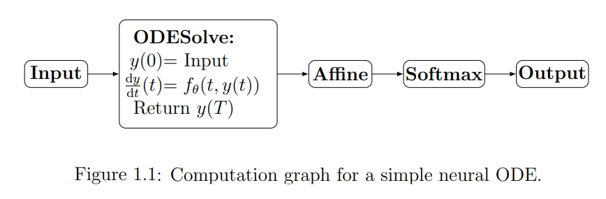
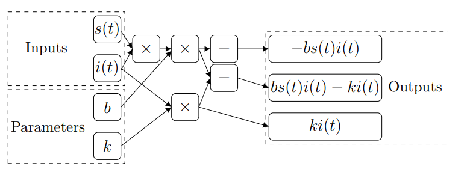
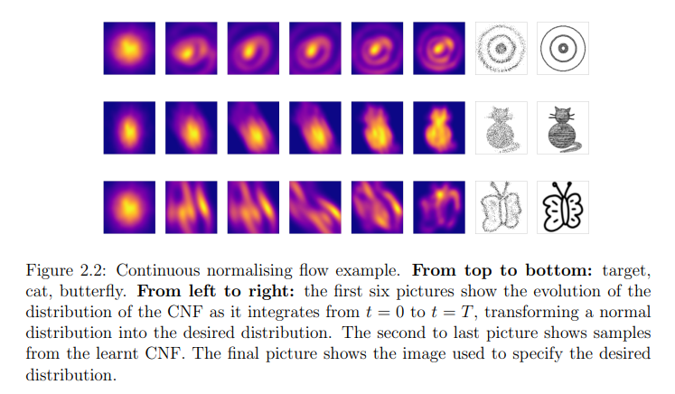

# Notes on Kidger's survey (PhD thesis, 2022)

##### Refer to [Kidger's seminars notes](\Kidger_vid.md) for introduction.

##### These notes/remarks are a complement to the survey's handwritten annotations on iPad, and highlight some of the concepts/questions/heuristics deemed personally most relevant.

## Chapter 1: Introduction
- Example of the computational graph of a simple NODE used for classification tasks:

- Computation graph of the SIR model, which is evidently differentiable:

- Physics-informed neural network (PINN) is about parametrizing the solution $y$ to $\frac{dy}{dt} = f(t, y(t))$ and fitting $y_\theta$ by minimizing a loss function of the form $\frac{1}{N} \sum_{i=1}^N \| \frac{dy_\theta}{dt}(t_i) - f(t_i, y_\theta(t_i)) \|$. Here, we are using an NN to obtain solutions to prespecified DEs, **which differs from NDEs**, where NNs are used to specify DEs. This distinction is somewhat similar to that between control theory and NCDEs

## Chapter 2: Neural Ordinary Differential Equations

### 2.1 Introduction
- For a neural network $f_\theta(t, y(t))$, it's typically true that it is continuous in $t$ and globally Lipschitz in $y(t)$, so by Picard-Lindelöf, an ODE specified by $f_\theta$ and some initial condition $y(0)=y_0$ has a unique solution
  
### 2.2 Applications
- In practice, for tasks such as image classification there's little to be gained by using a continuous-time model like NODEs: traditional residual networks and CNNs are easier to work with and are often superior
- The manifold hypothesis and its connection to NODEs?
- Universal differential equation (UDE)
  - augmenting a theoretical model (inductive bias) with NN correction terms
  - useful when the behavior is poorly-understood but there is sufficient data for exploiting NN's modelling capacity
- Hamiltonian neural network (HNN): assumes knowledge of some canonical coordinates used to parametrize $H_\theta$ in the Hamiltonian equations
- Lagrangian neural network (LNN): uses positions and velocities to parametrize $\mathcal{L}_\theta$ in the Euler-Lagrange equation 
- Both HNN and Lagrangian NNs are supervised learning models: to train them, one needs a dataset of trajectories from a physical systems with labels being the current states ($(q, p)$ for HNN and $(q, \dot{q})$ for LNN) and the target time derivatives ($(\dot{q}, \dot{p})$ for HNN and $\ddot{q}$ for LNN). An MSE loss between predicted and observed target derivatives is used in training

### 2.2.3. Continuous normalizing flows (CNF)
###### (switching to unsupervised learning)

Goal: Learn a generative model to approximate some time-stationary distribution over state space by training an NODE in distribution with a simple initial density.

Say we observe some distribution $\mathbb{P}$ (e.g. over pictures of cats) with density $\pi$ over state space $\mathbb{R}^{d_1\times\cdots d_k} = \mathbb{R}^d$. We have empirical samples of $\mathbb{P}$ and wish to approximate $\pi$, so that we can generate more samples (we sample from a trained NODE by first sampling from the initial distribution, then solving the trained ODE). In the following NODE, we want to train $f_\theta$ so that $y(T)$'s distribution is approximately $\mathbb{P}$:

$$y(0) \sim \mathcal{N}(0, I_{d\times d}) \hspace{1cm} \frac{dy}{dt}(t) = f_\theta(t, y(t)) \hspace{0.2cm} \text{ for }t \in [0, T]. \hspace{0.3cm} (2.4)$$

<u>Training (with maximum likelihood)</u>: we need a tractable density for the distribution of $y(T)$. *Theorem 2.3* (instantaneous change of variables) specifies that $p_\theta(t, \cdot)$, the $f_\theta$-dependent density of $y(t)$, evolves according a special case of Fokker-Planck for deterministic dynamics subject to random initial condition: 

$$\frac{d}{dt} \left(t \mapsto \log p_\theta(t, y(t))\right) (t) = -\sum_{k=1}^d \frac{\partial f_{\theta, k}}{\partial y_k}(t, y(t)) \hspace{0.3cm} (2.5)$$ 

where $y=(y_1,\ldots, y_d) \in \mathbb{R}^d$ and $f_\theta = (f_{\theta, 1}, \ldots, f_{\theta, d})$ is assumed to be globally Lipschitz. The RHS here is also known as the divergence of $f$ or the **trace of the Jacobian** of $f$. By solving (2.5) we can train a CNF via maximum likelihood: given a batch of empirical samples $y_1, \ldots, y_N \in \mathbb{R}^d$, we shall minimize 

$$-\frac{1}{N}\sum_{i=1}^N \log p_\theta(T, y_i) \stackrel{(2.5)}{=} -\frac{1}{N}\sum_{i=1}^N \left[\log p_\theta(0, y(0, y_i)) - \int_0^T\sum_{k=1}^d \frac{\partial f_{\theta, k}}{\partial y_k}(t, y(t, y_i))dt\right].$$ 

The RHS here is possible to evaluate: 

Starting from some terminal condition $y_i \in \mathbb{R}^d$, we may solve (using a numerical solver) 
$$ y(T, y_i) = y_i, \hspace{0.5cm} \frac{dy}{dt}(t, y_i) = f_\theta(t, y(t, y_i)) \hspace{0.2cm} \text{ for }t \in [0, T] \hspace{0.3cm} (2.6)$$ 
backwards-in-time from $t=T$ to $t=0$, giving us $y(t, y_i)$ for all $t \in [0, T]$, which is an input for the integral on RHS that can be solved as part of this backwards-in-time solve (by augmenting the ODE state: concatenating the integral together with (2.6) to form a system of DEs). Finally, we can easily evaluate $\log p_\theta(0, y(0, y_i))$ since $p_\theta(0, \cdot)$ is a normal distribution by setting.

Having evaluated this chunky RHS, the minimizing target (LHS) is backpropagated and the parameters $\theta$ are updated via gradient-descent.

Details on the backprop direction...

Since evaluating the RHS involves solving from $t=T$ to $t=0$, the backprop now progresses from $t=0$ to $t=T$, same direction as the sampling procedure at inference time.

...

On the efficient estimation of the trace Jacobian...

When evaluating the chunky RHS, the trace Jacobian (involving $f_\theta$) can be evaluated via autodifferentiation software. Simple? Sure. Efficient? Not so much: autodiff by nature calculates a product of Jacobians, not a sum, so one readily deduces that autodiff's cost of evaluating this trace is $\mathcal{O}(d^2)$. 

Instead, if we use Hutchinson's trace estimator, which is an unbiased Monte-Carlo estimation of the trace, only $\mathcal{O}(d)$ work is needed.

...

...

Advantages of CNF:
- Capable of learning relatively complex two-dimensional distributions: multiple modes, fine-scale "filaments" stretching away from the most massive part, etc
- Reduced computational complexity in Jacobian computation: unlike normalizing flows, CNF only needs the trace, not the determinant
- Natural invertibility: The model is inherently reversible because it is defined by an ODE that can be solved backwards-in-time
- Integrated density estimation: The change in probability density is calculated as a simple integral alongside the trajectory of the data, allowing for exact maximum likelihood training.

For coding example, see: https://docs.kidger.site/diffrax/examples/continuous_normalising_flow/

### 2.2.4 Latent ODEs

### 2.2.5 Residual networks

### 2.3 Choice of parametrization

### 2.4 Approximation properties

## Chapter 3: Neural Controlled Differential Equations

### 3.1 Introduction

### 3.2 Applications

### 3.3 Theoretical properties

### 3.4 Choice of parametrization

### 3.5 Interpolation schemes

## Chapter 4: Neural Stochastic Differential Equations

